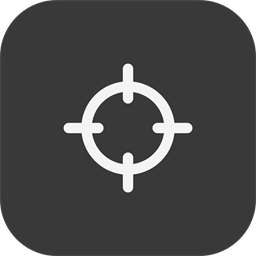
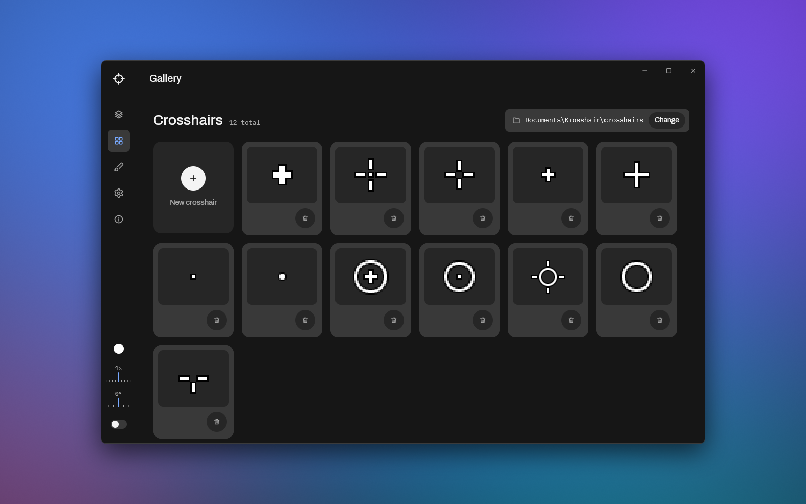

	

<h1 align="center">krosshair</h1>

	Open-source crosshair overlay.

	
	
	

## Features

- **GIFs support.** GIF crosshairs play in game with the frame timing of the file.
- **Built-in editor.** Crosses, T shapes, circles, dots or a 21x21 pixel grid, with color,
  opacity, rotation and outline.
- **Layers and profiles.** Nine screen anchors, pixel offsets, and a rotation, scale and color of
  their own for every layer; whole sets kept as profiles.
- **Safe.** Draws through proven overlay methods such as RTSS.
- **Highly customizable.** Use any PNG or GIF of your own, then scale it, turn it and tint it to
  fit any game.

## Get Started

You need Windows and RTSS 7.3.5 or newer.

1. Install [RTSS](https://www.guru3d.com/page/rivatuner-rtss-homepage/) and keep it running.
2. Turn on the on-screen display for your game in RTSS.
3. Download krosshair from [Releases](https://github.com/kirchesz/krosshair/releases), or
   [build it](docs/development.md).
4. Start `krosshair.exe`, open **Layers** and add a layer with a crosshair from the gallery.
5. Start the game: the crosshair is already there.

Settings are kept in `%APPDATA%\krosshair\config.json`, crosshairs in
`Documents\Krosshair\crosshairs`.

## Documentation

- [Local development](docs/development.md): requirements, building, common commands, releases
  and updates, testing against RTSS, app icon, fonts, colors, source layout
- [How the overlay works](docs/overlay.md): RTSS tags, the atlas, zoom, and what was measured
- [AGENTS.md](AGENTS.md): conventions, safe testing and the commit style, for contributors and
  coding agents

## Credits

Inspired by:

- [RTSS_Crosshair](https://github.com/LazySlavik/RTSS_Crosshair) by LazySlavik: the idea
- [x76.gg](https://x76.gg): many elements were inspired by the impression this site made

Made with:

- [RivaTuner Statistics Server](https://www.guru3d.com/page/rivatuner-rtss-homepage/) by Unwinder
- [gpui](https://www.gpui.rs/) by Zed Industries (Apache License 2.0)
- [Archivo](https://github.com/Omnibus-Type/Archivo) by Omnibus-Type and
  [IBM Plex Mono](https://github.com/IBM/plex) by IBM (SIL Open Font License 1.1)
- [Lucide](https://lucide.dev) for some of the icons (ISC License)

## License

krosshair is licensed under the [GNU General Public License v3.0](LICENSE). The bundled fonts
keep their own license, the SIL Open Font License 1.1; the texts are in
[assets/fonts](assets/fonts).
